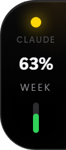
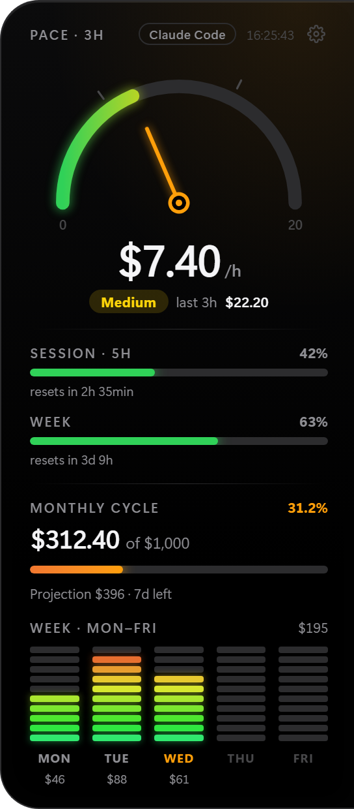
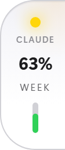
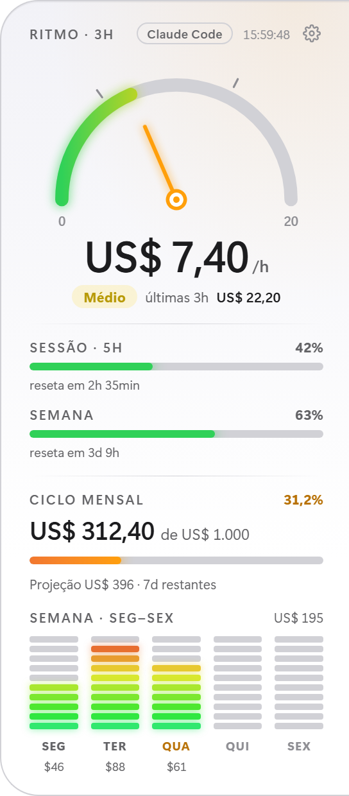

# Usage Widget — Cursor · Claude Code · Codex

**English** · [Português](README.pt-BR.md)

A Windows desktop widget that shows, without opening any dashboard, **how much you are spending** on coding agents and **how much of your plan's limits you have used**. It sits on the edge of the screen as a small tab, and hovering over it opens the full panel.

It works with **Claude Code**, **Codex** (OpenAI) and **Cursor**. You pick the source in the settings.

<table>
  <tr>
    <th>Dark theme</th>
    <th>Light theme</th>
  </tr>
  <tr>
    <td align="center">
      
      &nbsp;&nbsp;
      
    </td>
    <td align="center">
      
      &nbsp;&nbsp;
      
    </td>
  </tr>
</table>

<sub>Screenshots use sample data (generated by <code>tools/readme-shots.ps1</code>). The interface is available in English and Portuguese.</sub>

## What it shows

- **Collapsed tab:** the current source and the tightest plan limit (5-hour window or week), with a colored bar. Without plan limits, it shows the cycle spend in USD.
- **Pace:** a speedometer of your spend in USD/h over the last few hours (configurable window), rated low, medium or high.
- **Plan limits:** percentage used and time until reset for the short and long windows (Claude Pro/Max and ChatGPT plans in Codex).
- **Monthly cycle:** this month's spend against your quota, with a projection to the end of the cycle.
- **Week:** a Monday-to-Friday equalizer with each day's spend.
- **Alerts:** Windows notifications when the pace gets high and when the cycle crosses quota thresholds.

## Data sources

| Source | Where the cost comes from | Where the limits come from |
|---|---|---|
| **Claude Code** | Local logs in `~/.claude/projects` (estimate: tokens × model price) | Anthropic's usage API, using Claude Code's own login. If it does not respond, the last saved reading is shown (from the API or the optional status line). |
| **Codex** | Local logs in `~/.codex/sessions` (estimate: tokens × model price) | Codex's own logs (`rate_limits`) |
| **Cursor** | The cursor.com dashboard (your account's real numbers) | — |

In **Automatic** mode it uses the first source it finds, in this order: Claude Code, Codex, Cursor. When more than one is available, choose in **Settings > Data source**.

> [!NOTE]
> For Claude Code and Codex, the USD value is the **API-equivalent cost**, meaning what you would pay per token. It is not your bill: on subscription plans, the limit bars are what matter. Prices can be adjusted with environment variables (see below).

**Privacy:** everything runs on your machine. The Claude Code login is only sent to Anthropic (`api.anthropic.com` and, to renew the token when it expires, `platform.claude.com`). The renewed token is saved back to `~/.claude/.credentials.json`, the same way Claude Code itself does it. The Cursor cookie only goes to `cursor.com`. The cookie is stored in Windows Credential Manager.

## Installation

### Download

1. Download `cursor-usage-widget.exe` from the [releases page](../../releases/latest).
2. Put it in a folder of your own, for example `%LOCALAPPDATA%\CursorUsageWidget`, and run it.
3. Right-click the tray icon and check **Start with Windows**.

The executable is not signed, so Windows SmartScreen may ask for confirmation the first time (**More info > Run anyway**). It needs WebView2, which ships with Windows 10 and 11.

### Build from source

You need [Rust](https://rustup.rs) with the MSVC toolchain and the Visual Studio Build Tools ("Desktop development with C++" workload).

```powershell
git clone https://github.com/renanzm/cursor-usage-widget.git
cd cursor-usage-widget
powershell -ExecutionPolicy Bypass -File tools\install.ps1
```

The script builds in release mode, installs to `%LOCALAPPDATA%\CursorUsageWidget`, sets it to start with Windows and opens the widget.

## Usage

- **Hover** over the tab to open the panel. It closes on its own when the mouse leaves.
- **Double-click** to refresh right away.
- The **gear** in the panel, or **Settings…** in the tray menu, opens the settings.
- **Cursor:** the first time, paste the `WorkosCursorSessionToken` cookie (cursor.com › F12 › Application › Cookies) into the field shown in the widget.

### Settings

| Section | What you can change |
|---|---|
| Data source | Automatic, Claude Code, Codex or Cursor |
| Language | Automatic (follows Windows), English or Português |
| Monthly quota | Automatic (from Cursor) or a manual amount in USD |
| Pace | Calculation window, end of scale, and low/high thresholds |
| Week | Daily scale of the equalizer |
| General | Refresh interval |
| Position | Monitor and side of the screen (left or right) |
| Appearance | Dark or light theme |
| Colors | Accent and low/medium/high colors |

### Optional variables

Set them in the environment or in a `.env` file next to the executable:

| Variable | Purpose |
|---|---|
| `PRICE_OPUS_IN`, `PRICE_OPUS_OUT`, `PRICE_SONNET_*`, `PRICE_HAIKU_*` | Price per million tokens used for the Claude Code estimate |
| `PRICE_CODEX_IN`, `PRICE_CODEX_CACHED`, `PRICE_CODEX_OUT` | Price per million tokens used for the Codex estimate |
| `CLAUDE_DIR` | Claude Code projects folder, if not `~/.claude/projects` |
| `CODEX_HOME` | Codex folder, if not `~/.codex` |
| `CURSOR_COOKIE` | Cursor cookie (instead of pasting it into the widget) |

### Claude Code status line (optional)

This is a fallback for when the usage API does not respond. Point Claude Code's status line to the included script in `~/.claude/settings.json`, using forward slashes in the path:

```json
"statusLine": {
  "type": "command",
  "command": "powershell -NoProfile -ExecutionPolicy Bypass -File C:/path/to/cursor-usage-widget/tools/claude-statusline.ps1"
}
```

## Troubleshooting

```powershell
cursor-usage-widget.exe --once --source=claude   # or codex / cursor
```

This prints what the widget read as JSON and exits.

## Development

- `src-tauri/src`: Rust backend (Tauri 2). Files `claude.rs`, `codex.rs`, `usage.rs` (Cursor), `settings.rs` and `main.rs` (window, tray, positioning).
- `ui/`: plain HTML, CSS and JS interface, no build step.
- `cargo test` in `src-tauri` runs the tests.
- `tools/readme-shots.ps1` regenerates the images in this README.

## License

[MIT](LICENSE)
