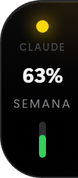
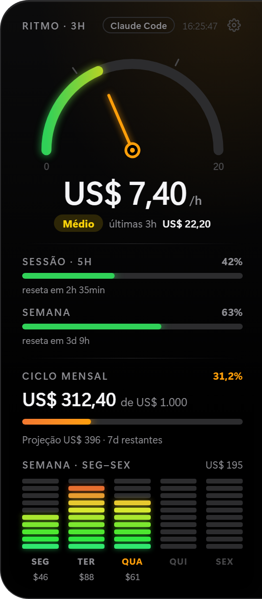
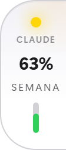
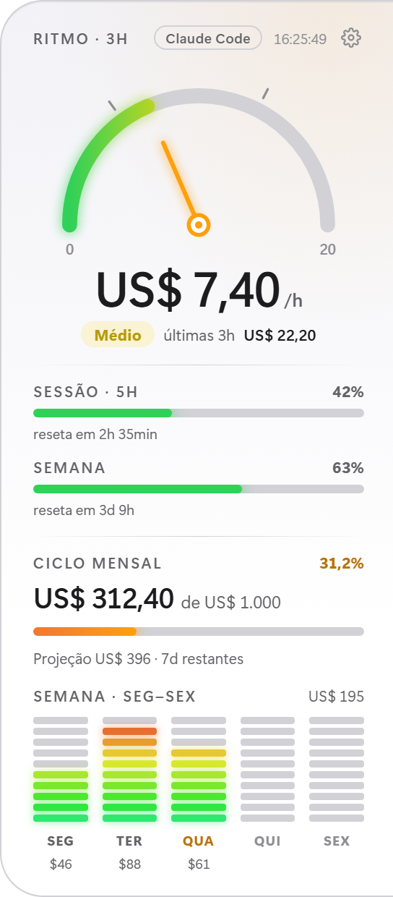

# Usage Widget — Cursor · Claude Code · Codex

[English](README.md) · **Português**

Um widget de mesa para Windows que mostra, sem abrir nenhum painel, **quanto você está gastando** com agentes de código e **quanto do limite do plano já usou**. Ele fica encostado na borda da tela como uma aba discreta. Basta passar o mouse para abrir o painel completo.

Funciona com **Claude Code**, **Codex** (OpenAI) e **Cursor**. Você escolhe a fonte nas configurações.

<table>
  <tr>
    <th>Tema escuro</th>
    <th>Tema claro</th>
  </tr>
  <tr>
    <td align="center">
      
      &nbsp;&nbsp;
      
    </td>
    <td align="center">
      
      &nbsp;&nbsp;
      
    </td>
  </tr>
</table>

<sub>As imagens usam dados fictícios (gerados por <code>tools/readme-shots.ps1</code>). A interface está disponível em inglês e português.</sub>

## O que ele mostra

- **Aba fechada:** a fonte atual e o limite mais apertado do plano (janela de 5h ou semana), com uma barrinha colorida. Sem limites de plano, mostra o gasto do ciclo em US$.
- **Ritmo:** velocímetro do gasto em US$/h nas últimas horas (janela configurável), classificado em baixo, médio ou alto.
- **Limites do plano:** porcentagem usada e tempo até o reset da janela curta e da longa (Claude Pro/Max e planos do ChatGPT no Codex).
- **Ciclo mensal:** gasto do mês contra a sua cota, com projeção até o fim do ciclo.
- **Semana:** equalizador de segunda a sexta com o gasto de cada dia.
- **Alertas:** notificações do Windows quando o ritmo fica alto e quando o ciclo passa de certas porcentagens da cota.

## Fontes de dados

| Fonte | De onde vem o custo | De onde vêm os limites |
|---|---|---|
| **Claude Code** | Logs locais em `~/.claude/projects` (estimativa: tokens × preço do modelo) | API de uso da Anthropic, com o login do próprio Claude Code. Se ela não responder, usa a status line opcional, que só funciona no Claude Code de terminal. |
| **Codex** | Logs locais em `~/.codex/sessions` (estimativa: tokens × preço do modelo) | Os próprios logs do Codex (`rate_limits`) |
| **Cursor** | Dashboard do cursor.com (valores reais da sua conta) | — |

No modo **Automático**, ele usa a primeira fonte encontrada nesta ordem: Claude Code, Codex, Cursor. Quando há mais de uma, você escolhe em **Configurações > Fonte de dados**.

> [!NOTE]
> Para Claude Code e Codex, o valor em US$ é o **equivalente de API**, ou seja, quanto custaria pagar por token. Não é a sua fatura: em planos por assinatura, o que importa são as barras de limite. Os preços podem ser ajustados por variáveis de ambiente (veja abaixo).

**Privacidade:** tudo roda na sua máquina. O token do Claude Code só é enviado para `api.anthropic.com`, e o cookie do Cursor só vai para `cursor.com`. Ele fica guardado no Gerenciador de Credenciais do Windows.

## Instalação

### Baixar pronto

1. Baixe `cursor-usage-widget.exe` na [página de releases](../../releases/latest).
2. Coloque o arquivo numa pasta sua, por exemplo `%LOCALAPPDATA%\CursorUsageWidget`, e abra.
3. Clique com o botão direito no ícone da bandeja e marque **Iniciar com o Windows**.

O executável não é assinado, então o Windows SmartScreen pode pedir confirmação na primeira vez (**Mais informações > Executar assim mesmo**). Ele precisa do WebView2, que já vem no Windows 10 e no 11.

### Compilar do código

Você vai precisar de [Rust](https://rustup.rs) com o toolchain MSVC e das Visual Studio Build Tools (carga "Desenvolvimento para desktop com C++").

```powershell
git clone https://github.com/renanzm/cursor-usage-widget.git
cd cursor-usage-widget
powershell -ExecutionPolicy Bypass -File tools\install.ps1
```

O script compila em release, instala em `%LOCALAPPDATA%\CursorUsageWidget`, configura o início com o Windows e abre o widget.

## Uso

- **Passe o mouse** na aba para abrir o painel. Ele fecha sozinho quando o mouse sai.
- **Duplo clique** atualiza na hora.
- **Engrenagem** no painel ou **Configurações…** no menu da bandeja abre as opções.
- **Cursor:** na primeira vez, cole o cookie `WorkosCursorSessionToken` (cursor.com › F12 › Application › Cookies) no campo que aparece no widget.

### Configurações

| Seção | O que dá para ajustar |
|---|---|
| Fonte de dados | Automático, Claude Code, Codex ou Cursor |
| Idioma | Automático (segue o Windows), English ou Português |
| Cota mensal | Automática (do Cursor) ou um valor manual em US$ |
| Ritmo | Janela de cálculo, fim da escala e limites de baixo e alto |
| Semana | Escala diária do equalizador |
| Geral | Intervalo de atualização |
| Posição | Monitor e lado da tela (esquerdo ou direito) |
| Aparência | Tema escuro ou claro |
| Cores | Destaque e cores de baixo, médio e alto |

### Variáveis opcionais

Defina no ambiente ou num arquivo `.env` ao lado do executável:

| Variável | Para quê |
|---|---|
| `PRICE_OPUS_IN`, `PRICE_OPUS_OUT`, `PRICE_SONNET_*`, `PRICE_HAIKU_*` | Preço por milhão de tokens usado na estimativa do Claude Code |
| `PRICE_CODEX_IN`, `PRICE_CODEX_CACHED`, `PRICE_CODEX_OUT` | Preço por milhão de tokens usado na estimativa do Codex |
| `CLAUDE_DIR` | Pasta dos projetos do Claude Code, se não for `~/.claude/projects` |
| `CODEX_HOME` | Pasta do Codex, se não for `~/.codex` |
| `CURSOR_COOKIE` | Cookie do Cursor (alternativa a colar no widget) |

### Status line do Claude Code (opcional)

É uma reserva para quando a API de uso não responder. Aponte a status line do Claude Code para o script incluído, em `~/.claude/settings.json`, usando barras normais no caminho:

```json
"statusLine": {
  "type": "command",
  "command": "powershell -NoProfile -ExecutionPolicy Bypass -File C:/caminho/para/cursor-usage-widget/tools/claude-statusline.ps1"
}
```

## Diagnóstico

```powershell
cursor-usage-widget.exe --once --source=claude   # ou codex / cursor
```

Esse comando imprime em JSON o que o widget leu e sai.

## Desenvolvimento

- `src-tauri/src`: backend em Rust (Tauri 2). Arquivos `claude.rs`, `codex.rs`, `usage.rs` (Cursor), `settings.rs` e `main.rs` (janela, bandeja, posição).
- `ui/`: interface em HTML, CSS e JS puros, sem build.
- `cargo test` em `src-tauri` roda os testes.
- `tools/readme-shots.ps1` regenera as imagens deste README.

## Licença

[MIT](LICENSE)
